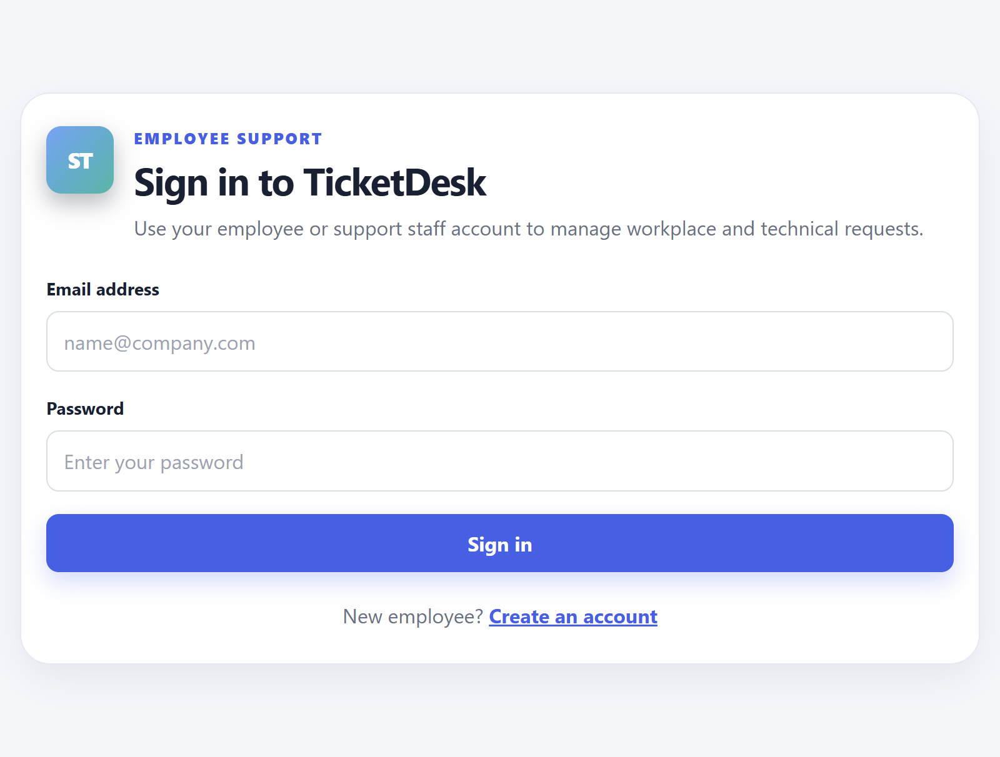
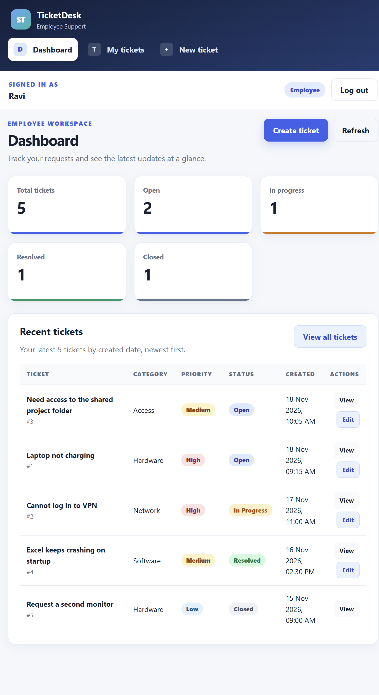
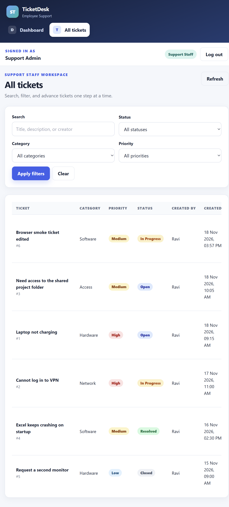

# Day 4 Submission — Poojitha

## Employee Support Ticket Management Application

| Item | Detail |
|---|---|
| Date | 18 Nov 2026 |
| Repository | `C:\Users\Poojitha\Documents\Employee-Support-Ticket-App` |
| GitHub link | **Pending** — no remote was configured in the workspace at submission time |
| Source prompt | [PRODUCT_PROMPT.md](PRODUCT_PROMPT.md) |
| Requirements baseline | [SPEC.md](SPEC.md) — RD-01 through RD-16 |
| Implementation plan | [PLAN.md](PLAN.md) |
| Setup and commands | [README.md](README.md) |
| Progress record | [PROGRESS.md](PROGRESS.md) |

---

## 1. Product Prompt

The complete original product prompt is preserved in [`PRODUCT_PROMPT.md`](PRODUCT_PROMPT.md). It defines the Employee Support Ticket Management Application, its roles, ticket rules, validation, status workflow, sample data, UI, database, security, testing, and staged delivery requirements. It also explicitly defers ticket comments to a later enhancement.

No original requirement was removed or replaced. Review decisions RD-01 through RD-16 resolved open questions and are recorded in [`SPEC.md`](SPEC.md).

## 2. Specification

[`SPEC.md`](SPEC.md) is the finalized requirements baseline. It was completed before implementation and then left unchanged except for its final status line. Key confirmed decisions include:

- Status path: Open → In Progress → Resolved → Closed, one step forward only
- HTTP codes: 401 unauthenticated/login failure, 403 authorization, 400 invalid input, 404 missing ticket
- Check order: authentication → missing ticket → authorization → invalid input
- UTC storage and Asia/Kolkata display
- Title maximum 100; description maximum 2,000 after trimming
- Trimming and email normalization rules
- No arbitrary Employee account limit; no public Support Staff registration
- Responsive professional UI and fully functional controls
- Database reliability requirements
- Comments excluded from initial scope

## 3. Plan

[`PLAN.md`](PLAN.md) resolved the technical decisions TD-01 through TD-05:

| Decision | Resolution |
|---|---|
| Stack | React + Vite + CSS; FastAPI + SQLAlchemy; SQLite default with `DATABASE_URL` for PostgreSQL-compatible configuration |
| Sessions | Opaque server-side tokens; only SHA-256 hashes stored; HttpOnly cookie; logout revocation |
| REST API | Paths, bodies, and success codes defined in `PLAN.md` section 6 |
| Identifiers | Integer auto-increment primary keys |
| Seed passwords | Environment variables or interactive prompts; no hardcoded secrets |

## 4. Prompts Used

### Approval prompt

> Please review the attached PRODUCT_PROMPT and existing SPEC. Inspect the project and Git history, reuse existing work, preserve every requirement and approved decision, finalize SPEC, then create PLAN. STOP after SPEC.md and PLAN.md are ready. Show me a concise summary and wait for my explicit approval. Do not write application code before approval.

### Implementation prompt

> Implement the complete Employee Support Ticket App using the existing SPEC.md and PLAN.md as the source of truth. Do not rewrite them or restart planning.
>
> Build the full React + Vite frontend and FastAPI + SQLAlchemy backend with SQLite/PostgreSQL-compatible configuration. Implement secure registration/login, backend-enforced Employee/Support Staff roles, dashboards, ticket creation, viewing, editing, filtering, and status updates. Enforce every validation, permission, database, and workflow rule in the specification. Employees access only their own tickets; Support Staff access all tickets and manage statuses. Make every visible UI control functional. No dummy buttons, placeholder pages, or fake functionality. Create a polished, responsive UI with readable fonts, consistent spacing, and no overlapping or clipped content. Ensure persistence, secure password hashing, session revocation, safe errors, and no hardcoded secrets. Test the complete workflows, fix defects, and commit each verified milestone to Git. Write a useful README.md with setup, run, and test instructions. Do not implement comments yet. Add them later as a separate enhancement, including comments on Closed tickets. Maintain PROGRESS.md with completed work, pending tasks, commands, test results, and the next step whenever you pause. Work efficiently, reuse existing files, and continue through implementation without asking for approval at every milestone. Never claim something works without testing it. Start now.

## 5. What Was Generated

- The specification was finalized and the implementation plan was created before code generation.
- All backend and frontend application code, scripts, automated tests, README, and this submission document were generated by AI during the approved implementation session.
- The user supplied the original product prompt, approved the decisions and plan, and requested implementation. No additional manual source-code edits were reported.
- `PRODUCT_PROMPT.md` was preserved as the original source prompt.

## 6. Git Checkpoints

| Commit | Description | Verification before commit |
|---|---|---|
| `b23edea` | FastAPI backend, database layer, authentication, ticket APIs, and tests | 21 backend tests passed after fixing the SQLite constraint defect |
| `ecc49a8` | React + Vite frontend and genuine browser screenshots | Production build succeeded; live browser workflow smoke test passed |
| `9453886` | Literal LIKE wildcard search defect fix | Full suite passed with 22 tests including the new regression test |

No `.env`, database file, `node_modules`, or build output was committed. No production secrets or private keys appear in committed source; the seeded demonstration passwords shown in setup commands are local-only examples supplied through environment variables.

## 7. Genuine Screenshots and Evidence

Captured in the in-app browser at an 800 px viewport while both servers were running locally.







### Browser smoke checklist

| Check | Result |
|---|---|
| Employee login with seeded account | Passed |
| Dashboard counts and recent 5 tickets | Passed |
| Create ticket | Passed — new ticket detail opened |
| Edit ticket | Passed — title saved, Last Updated Date changed |
| Closed ticket hides Edit action | Passed |
| Support login and dashboard counts | Passed |
| Support ticket list and creator display | Passed |
| Search `VPN` | Passed — returned only the VPN ticket |
| Status filter `Resolved` | Passed — returned only the resolved ticket |
| Clear filters | Passed — all tickets returned |
| Status advance action | Passed — HTTP 200 and list refreshed |
| Registration | Passed — account created and success message shown |
| Employee direct `/support` request | Passed — redirected to 403 page |
| Unknown route | Passed — 404 page shown |
| Employee access to another employee's ticket | Passed — backend 403 message displayed |
| Missing ticket detail | Passed — backend 404 message displayed |
| Horizontal page overflow at 800 px | None detected (`scrollWidth` 785 <= `innerWidth` 800) |

Screenshots at additional desktop and phone widths: **Pending** — the available browser viewport was 800 px; no evidence was fabricated for other widths.

## 8. Test Results

Command:

```powershell
.venv\Scripts\python.exe -m pytest backend/tests -v
```

Final result on 18 Nov 2026:

```text
22 passed, 1 warning in 8.28s
```

The warning is:

```text
StarletteDeprecationWarning: Using `httpx` with `starlette.testclient` is deprecated
```

It is not a test failure.

Frontend build command:

```powershell
cd frontend
npm run build
```

Result: Vite 8.3.8 production build succeeded.

Coverage areas:

- Registration validation, trimming, case-insensitive email normalization, duplicate rejection, client role rejection
- Login success/failure, missing fields, protected `/me`, logout revocation
- Ticket create validation including 100/2,000 character boundaries
- Employee ownership, edit permissions, Closed ticket restriction
- Support Staff search, filters, dashboard counts, status transitions
- Required error codes and check order, including missing ticket before authorization
- Persistence through a new database connection
- Constraints and relationships in SQLite schema
- Idempotent sample seed and exact sample values
- Literal handling of SQL LIKE wildcards

## 9. Defect Reports

### Defect 1 — SQLite table creation failed

- **Reproduction:** Run `create_tables()` against a fresh SQLite database.
- **Actual behavior:** `sqlite3.OperationalError: no such function: char_length`; the `tickets` table was not created.
- **Cause:** Check constraints used the PostgreSQL-style `char_length()` function, which SQLite does not provide.
- **Fix:** Replaced both constraints with portable `length(title) > 0` and `length(description) > 0`.
- **Retest:** `create_tables()` printed `tables ok`; the full backend suite passed.
- **Commit:** `b23edea` (verified before commit).

### Defect 2 — Search wildcards were not literal

- **Reproduction:** Sign in as Support Staff with at least two tickets, then request `GET /api/support/tickets?search=%25`. Equivalent regression test: `test_search_treats_sql_like_wildcards_literally`.
- **Expected:** No tickets, because no stored field contains a literal `%`.
- **Actual behavior:** All tickets were returned. The pre-fix regression test failed with two unexpected tickets.
- **Cause:** The user search term was embedded directly in a SQLAlchemy `ilike()` pattern, so `%` and `_` were interpreted as SQL LIKE wildcards.
- **Fix:** Escape backslash, `%`, and `_` in user input and pass `escape="\\"` to each `ilike()` comparison.
- **Retest:** The focused regression test passed; full suite then reported 22 passed.
- **Commit:** `9453886`.

## 10. Review Notes

| Area | Review outcome |
|---|---|
| Input validation | Backend validates all ticket fields and registration fields; titles/descriptions/full names trimmed; passwords never trimmed; email normalized; max lengths enforced after trimming |
| Secrets | No hardcoded passwords or tokens; `.env` ignored; only variable names in `.env.example`; seed and Support initialization require env variables or prompts |
| Password security | Argon2 hashing; verification uses exact submitted password; hashes never returned by API |
| Authorization | Role and ownership checked in backend services/dependencies; frontend hiding is not relied on for security; direct API checks verified by tests and browser |
| Error handling | 400/401/403/404 applied in required order; consistent JSON detail; no stack traces or sensitive data exposed; rejected writes leave timestamps unchanged |
| Database handling | Single engine/session layer; relationships and constraints defined; multi-step writes committed once; rollback on integrity errors; idempotent seed; persistence verified through a new connection |
| Code organization | Layered routes → services → models; shared API client and reusable frontend components; no duplicated database configuration |
| Dependencies | Python dependencies pinned by minimum versions; frontend uses current React/Vite tooling. `npm audit` reports high-severity development-only advisories in Vite's `picomatch`/`fdir`/`tinyglobby` chain with no published fixed `picomatch` version; production build succeeds and the dev server should not be exposed publicly |
| Scope | No comment model, API, UI, seed data, or display exists; comments remain a separate future enhancement |

## 11. Known Gaps and Pending Items

- Comments are intentionally not implemented.
- GitHub repository link: **Pending** (no remote configured).
- Screenshots at desktop and phone widths beyond 800 px: **Pending**.
- PostgreSQL runtime test: **Pending** (configuration supports `DATABASE_URL`, but automated verification used SQLite).
- `npm audit` development-dependency advisories remain as described above.
- Email/SMS notifications, AI classification, chat, payments, and enterprise admin features are out of scope.

## 12. Commands Used

```powershell
python -m venv .venv
.venv\Scripts\python.exe -m pip install -r backend\requirements.txt
.venv\Scripts\python.exe -m pytest backend/tests -v
$env:SEED_EMPLOYEE_PASSWORD='EmployeeSeed123'
$env:SEED_SUPPORT_PASSWORD='SupportSeed123'
.venv\Scripts\python.exe -m backend.scripts.seed_sample_data
.venv\Scripts\python.exe -m uvicorn backend.app.main:app --host 127.0.0.1 --port 8000
cd frontend
npm install
npm run build
npm run dev
```

All results recorded above are from actual commands and browser interactions performed during this session. Missing evidence is marked Pending rather than fabricated.
